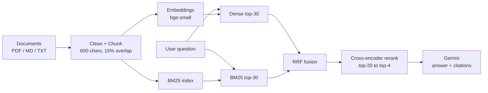

# 🔎 Hybrid RAG + Reranking

A question-answering system over your own documents. It combines **semantic (dense) search** and **keyword (BM25) search**, merges them with **Reciprocal Rank Fusion**, re-scores the best candidates with a **cross-encoder reranker**, and has **Gemini** answer using only the retrieved text, with citations.

> Built to learn and demonstrate how modern retrieval pipelines work, and to *measure* whether each stage actually helps.

## Why hybrid + reranking?

| Method | Strength | Weakness |
|---|---|---|
| Dense (embeddings) | Understands meaning and paraphrases | Misses exact codes, names, IDs (e.g. `E-4021`) |
| BM25 (keywords) | Nails exact terms | Misses synonyms and rephrasing |
| **Hybrid (RRF)** | Covers both | Ranking still coarse |
| **+ Reranker** | Reads query + passage together for precise relevance | Slower, so applied only to a short list |

## Architecture



## Tech stack
- **Python 3.10+**
- **Embeddings:** `BAAI/bge-small-en-v1.5` (sentence-transformers, runs locally)
- **Keyword search:** `rank-bm25`
- **Reranker:** `BAAI/bge-reranker-base` (cross-encoder, runs locally)
- **LLM:** Google Gemini via `google-genai`
- **UI:** Streamlit and a command-line app

## Quick start

```bash
# 1. Create and activate a virtual environment
python -m venv .venv
.venv\Scripts\activate          # Windows
# source .venv/bin/activate     # Mac/Linux

# 2. Install
python -m pip install -r requirements.txt

# 3. Add your Gemini key (free at https://aistudio.google.com/apikey)
copy .env.example .env          # Windows  (use cp on Mac/Linux)
# edit .env and paste your key

# 4. Put your .pdf / .md / .txt files in data/, then build the index
python -m src.index

# 5. Ask questions
python -m src.app               # command line
streamlit run streamlit_app.py  # web UI
```

Always run commands from the project root.

## Evaluate it

```bash
python -m eval.run_eval
```

Compares four configurations on `eval/questions.json` using **Recall@5** and **MRR**, and saves a table to `eval/results.md`.

### Results

The evaluation script (`eval/run_eval.py`) compares dense, BM25, hybrid (RRF), and hybrid + rerank using Recall@5 and MRR on a question set you provide in `eval/questions.json`. Results on my own document set are coming soon.

Demo corpus: a PDF on 10 RAG architectures

## Project structure

```
hybrid-rag/
├── data/               # your documents
├── src/
│   ├── config.py       # all settings in one place
│   ├── ingest.py       # load + clean files
│   ├── chunk.py        # overlapping chunks + metadata
│   ├── index.py        # build dense index
│   ├── retrieve.py     # dense, BM25, RRF
│   ├── rerank.py       # cross-encoder reranker
│   ├── pipeline.py     # one search() for all configurations
│   ├── generate.py     # Gemini answer with retry
│   ├── app.py          # CLI
│   └── list_models.py  # helper: list usable Gemini models
├── eval/
│   ├── questions.json  # ground-truth test questions
│   └── run_eval.py     # metrics for 4 configurations
├── docs/PROJECT_EXPLAINED.md
├── streamlit_app.py    # web UI
└── requirements.txt
```

## Key design decisions
- **RRF over score blending:** it uses ranks, so incompatible score scales (cosine vs BM25) never need reconciling.
- **Retrieve wide, rerank narrow:** 30 per retriever, fuse, rerank 20, send 4 to the LLM.
- **Grounded prompt:** the LLM must answer only from the context and say "I don't know" otherwise.
- **Metadata kept on every chunk** (source file, page) for citations.
- **Evaluation first:** every change is judged against a fixed question set rather than by eye.

## Limitations
- Plain-text extraction from PDFs; tables and images are not handled.
- Dense index is an in-memory numpy matrix. Fine for thousands of chunks, not millions.
- English-only default models.
- Evaluation uses phrase-matching ground truth, which is simple but strict.

## Future work
Query rewriting, metadata filters, contextual chunk headers, parent-document retrieval, a vector database (Chroma/FAISS/Qdrant), table-aware PDF parsing.

## Troubleshooting
- `No module named 'src'`: run from the project root with `python -m src.app`.
- Gemini 404 model error: run `python -m src.list_models` and set `GEMINI_MODEL` in `.env`.
- Gemini 429: free-tier rate limit; the app retries automatically, or wait a minute.

## License
MIT
